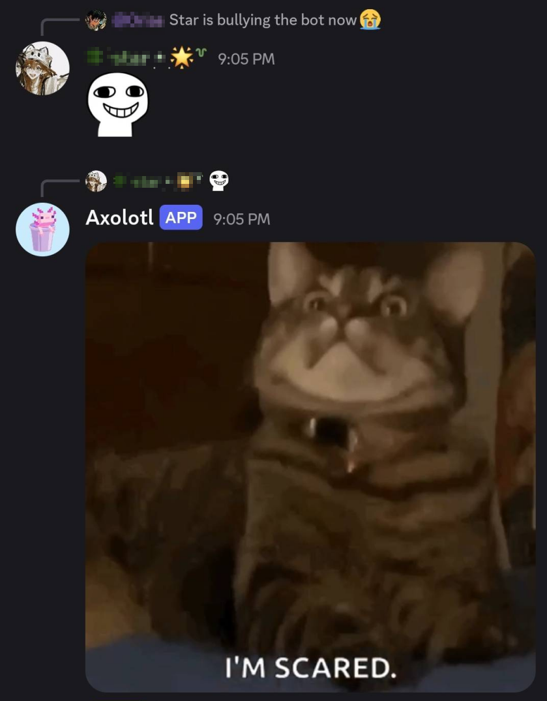
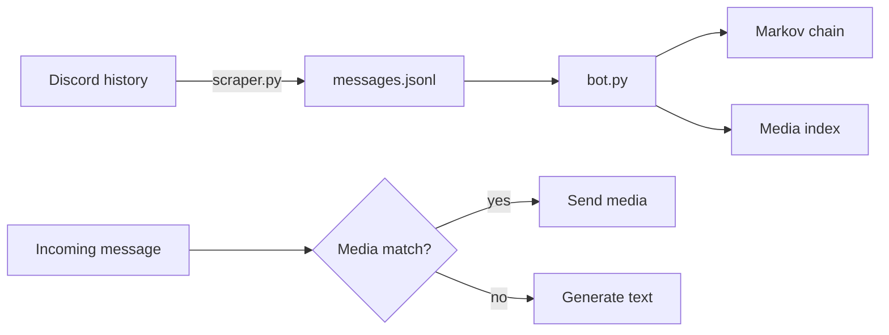

I remember reading GeeksforGeeks pages on how to make a chatbot before the AI era, but I never got around to making one. So, I spent the last few days building [DumbCord](https://github.com/Bittu5134/DumbCord), a chatbot that uses a Markov chain to generate responses.

To train the bot, I used chats from my [Discord server](https://bittu.dev/discord/). And, as you might expect from a Discord server, the chats were all over the place, so the bot came out completely unhinged.

{style=max-height:50vh;}

## How it works

DumbCord uses [markovify](https://github.com/jsvine/markovify) to build a probability table from past messages sent by users, breaking them into words and counting which words tend to follow each pair of words. It then walks that second-order Markov chain, sampling each next word based on the preceding two, and accepts the resulting text after it passes the configured validation checks. That's it. That's the model.

There is an extra layer on top of this that extracts all URLs from the messages and then converts them into hashes that the bot can use as a single token; otherwise, the bot would be incapable of sending GIFs.

Finally, there is a sanitization layer _(configurable)_ that can be used to sanitize @everyone, @here, and @mention pings, which the bot may otherwise generate depending on the training data.

All of this code is split between two files, `bot.py` and `scraper.py`: the scraper extracts the chats from the server, while `bot.py` contains the code for the actual bot that generates and sends replies.

## So... is this a neural network?

No. Not even close. The reason I insist on calling this bot "dumb" is that it has no idea what it's generating. While this model "predicts the next word," similar to popular LLMs these days, the underlying mechanism is completely different.

| | DumbCord | A neural network |
|---|---|---|
| What it stores | Counted transitions between words, in a lookup table | Learned weights across layers of "neurons" |
| How it "learns" | Counting occurrences while reading a file | Gradient descent and backpropagation |
| Generalization | None, it can only recombine n-grams it has seen | Generalizes through dense embeddings |
| Parameters | Zero | Millions to billions |

So what I actually built is a language model, just not a neural one. Modern LLMs are built on its more powerful cousins, such as *neural probabilistic language models*, *RNNs*, and *transformers*.

The genuine advantage of the dumb version is that it fits in a few megabytes of RAM, trains in a second, needs no GPU, and there is no possible way to prompt-inject it into being polite.

## Running it yourself

Refer to the [Quickstart Guide](https://github.com/Bittu5134/DumbCord) for instructions on running the bot yourself.

## Showcase

Here are some screenshots of people from the [Discord server](https://bittu.dev/discord/) interacting with the bot.

## Food for Thought

After letting other users interact with the bot, it made me wonder: if just a few weeks' worth of chats from one Discord server can make a bot this chaotic, then just how much stuff are the big LLMs hiding behind their guardrails, and what happens when those guardrails no longer work?

## Conclusion

This was a fun weekend project for me. The full source is on [GitHub](https://github.com/Bittu5134/DumbCord). Train it on your own server and see how much of yourself you recognize.
