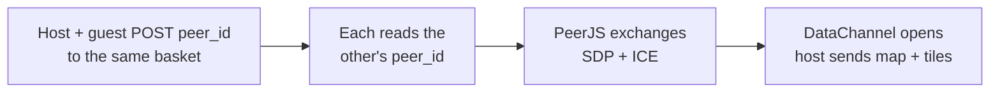

I have a bad habit of building multiplayer things and then refusing to pay for a multiplayer server. [GeoShuffle](https://geoshuffle.bittu.dev) is the latest one: a sliding puzzle where the picture is a satellite photo of somewhere on Earth, and the goal is to put it back together in as few moves as possible.

The part people ask about is the multiplayer, because there is no game server anywhere. Two browsers just... find each other and play.

That only works because of a second project, [PeerBasket](https://peerbasket.bittu.dev), the little discovery server I built to make the "finding each other" part not miserable. So this post is two introductions at once: what GeoShuffle is, and what PeerBasket is — explained like you're five, without pretending the hard parts don't exist.

## The ELI5 version

Imagine you and a friend want to talk on the phone, but neither of you knows the other's number.

You need three things:

1. **A phone number.** In WebRTC, that's a PeerJS ID — a long random string that identifies one browser tab.
2. **A notice board.** You write your number on a sticky note, stick it under a room name, and your friend does the same. Now you can both read each other's notes. That's PeerBasket.
3. **A phone company to connect the call.** Once you both have numbers, something still has to turn "call this person" into an actual connection. PeerJS's signalling server handles that, and a STUN lookup tells each browser what its public address looks like from the outside.

And then the important bit: **the conversation happens directly between the two phones.** The notice board never hears it. The phone company hangs up once the call is connected.

That's the whole architecture. GeoShuffle's puzzle data never touches PeerBasket, and PeerBasket has no idea a game is happening.

>[!IMPORTANT]
> There is no relay in the middle. If two networks refuse to talk to each other (some corporate networks and symmetric NATs do), the match simply fails to connect. That's the trade-off for not paying for a TURN server.

## What GeoShuffle is

A sliding puzzle with a 6×4 grid, 23 numbered tiles and one empty slot. The image behind them is a satellite view of a real place, pulled from a data file of countries, regions and coordinates. Slide with WASD, the arrow keys, a click, or a swipe.

Get stuck for 45 seconds and it offers a hint. Solve it and the game reveals where on Earth you were staring at, plus a scorecard with your time, your move count and your leaderboard rank. There's a global leaderboard backed by Supabase, a local history of your own runs, and two ways into multiplayer: a private lobby with a 6-letter room code, or a quick match button that pairs you with a random person who is also clicking buttons alone.

## How two browsers find each other

A private lobby is the easy one. The host generates a room code like `K3F9QZ` and starts posting its PeerJS ID to a PeerBasket basket named `geoshuffle-K3F9QZ`, re-posting every 12 seconds to stay listed. The guest enters the code, posts its own ID to the same basket, and gets back the peers already sitting there. One of them is the host. The guest dials it, and the game begins.

Quick match is the same idea with a shared basket called `geoshuffle-public-matchmaking`. Both players post their ID and both get the list back — which means both would dial each other at the same time if nobody intervened. So there's a tie-break: the peer with the lexicographically smaller ID dials, and the other side waits. One handshake instead of two, and no race where two connections open and one has to be thrown away.

When the dial connects, the guest sends a `match_request`, the host replies with `match_accept` and a fresh room code, and both sides flip into the playing state.



## What PeerBasket actually is

A small Go service with one endpoint, backed by Redis. You POST a `peer_id` to `/basket/:name`, and the response contains every active peer in that basket:

```js
const res = await fetch("https://peerbasket.bittu.dev/basket/my-room", {
  method: "POST",
  headers: { "Content-Type": "application/json" },
  body: JSON.stringify({ peer_id: myPeerId }),
});
const { peers } = await res.json();
```

That single request does three jobs at once: it registers you, refreshes your heartbeat, and hands back everyone else. No separate join, no leave, no account.

Under the hood, each basket is a Redis sorted set where the score is the last time a peer checked in. Every request drops entries older than 30 seconds, returns the most recent `limit` peers, and refreshes the key's one-hour expiry. Close your tab and you stop heartbeating; 30 seconds later you're gone. No cleanup job, no ghost lobbies.

Even the "N online" counter in GeoShuffle is just this API: it posts a fake probe peer to a `geoshuffle-online` basket and reads the total back.

PeerBasket isn't GeoShuffle-specific, either. The repo ships examples for a 1:1 matchmaker chat, a browser-to-browser file drop, and a group video room. It pairs with anything that has a peer ID and no desire to run a lobby database.

## Who owns the board

Once the channel is open, the host is the source of truth for the puzzle. It picks a map, shuffles it, and sends the whole thing across:

```js
conn.send({ type: "start_game", mapIndex, tiles });
```

The guest applies those tiles and starts from the exact same scrambled board, so nobody has to argue about whether the puzzle was solvable.

After that the two boards run independently — this is a race, not a turn-based game. What actually crosses the wire is small:

| Message | Sent by | What's inside |
|---|---|---|
| `start_game` | host | the map and the shuffled tile array |
| `move_update` | both | your current move count |
| `victory` | both | your final time and move count |
| `request_new_game` | guest | "run it back" |
| `opponent_ready_replay` | both | "I'm ready when you are" |
| `ping` / `pong` | both | heartbeat |

The board is shared once at the start, and the live sync is your move count ticking up next to your opponent's. Which, honestly, is the fun part: watching someone else suffer through the same puzzle at the same speed as you.

## Keeping the line honest

A WebRTC connection can die quietly, especially when one side walks away from the laptop. So there's a heartbeat over the data channel itself: every 10 seconds each side sends a `ping`, and three missed beats in a row — about 30 seconds — closes the connection and shows the disconnect state. A new handshake gets 10 seconds before it's considered dead, which is also how quick match recovers: a slow candidate just means "search again".

## What I would change

- **Add a TURN relay.** It's the one missing piece for reliability on hostile networks, and it costs money, which is why it isn't there yet.
- **Make presence sharper.** Thirty seconds is generous for a heartbeat and lazy for a queue. Shorter timeouts, or a real queue endpoint, would make quick match feel snappier.
- **More than two players.** PeerBasket doesn't care how many peers sit in a basket, but a 3-player sliding puzzle race needs more thought than a 2-player one.

The thing I keep coming back to is that the hard part was never the puzzle. Sliding tiles is a solved problem from 1880. The hard part was getting two strangers' browsers to agree on where to meet — and that's the bit I now reuse everywhere.

## Try it

- Play: [geoshuffle.bittu.dev](https://geoshuffle.bittu.dev)
- Source: [GeoShuffle](https://github.com/Bittu5134/GeoShuffle)
- Discovery server: [PeerBasket](https://github.com/Bittu5134/PeerBasket) (Go, Gin, Redis, free for anyone to use)

## Conclusion

GeoShuffle's multiplayer is two phones and a notice board. PeerBasket holds the sticky notes, PeerJS connects the call, and the game itself is two browsers shouting their move counts at each other over a direct line.

If you're building something that needs peers to find each other without a backend, that notice board is the only part you actually have to write. The rest is a sliding puzzle from 1880.
