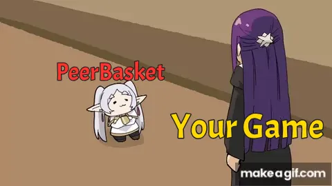
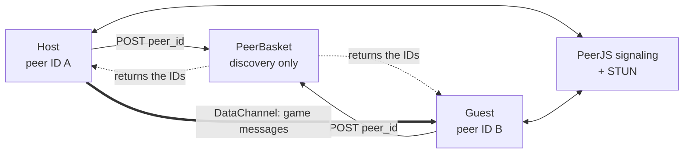

I enjoy building mini-games, even if nobody plays them TwT. The problem is that adding multiplayer usually means paying for a backend server.

I ran into that while building [GeoShuffle](https://geoshuffle.bittu.dev). I wanted two players to play against each other, but the game is a static website and I did not want to start paying for a server.

WebRTC solves most of it, because it can connect two browsers directly over the internet, and PeerJS gives it a simpler interface. What PeerJS does not do is tell you which peer ID to dial. Something still has to hold a list of who is currently looking for a game, and keeping that list yourself means paying for uptime.

That list is my second project, [PeerBasket](https://peerbasket.bittu.dev). It is a shared notice board that already runs at [peerbasket.bittu.dev](https://peerbasket.bittu.dev), so a game only has to post one ID to one address.



## How the pieces fit

PeerBasket is a small tool that any browser-based P2P game can use to find players.

A P2P game has three jobs:

1. **Discovery:** find another player's peer ID.
2. **Connection:** establish a browser-to-browser WebRTC connection.
3. **Gameplay:** exchange the actual game data and events.

PeerBasket handles only the first job. PeerJS handles the connection setup, and the game sends its own data through the WebRTC data channel once it is open. A static site can therefore support multiplayer without routing gameplay through a backend.

In GeoShuffle the flow looks like this:

1. Each browser creates a PeerJS ID.
2. Both players POST their IDs to the same PeerBasket basket.
3. PeerBasket returns the active IDs in that basket, newest first.
4. One player uses the discovered ID to start a PeerJS connection.
5. Once the connection opens, GeoShuffle sends puzzle and match updates directly between the browsers.

PeerJS's signaling server passes the connection details between the two browsers, and a STUN server helps each one learn its public address. Neither is part of the game itself.

>[!IMPORTANT]
> There is no relay in the middle. If two networks refuse to talk to each other, as some corporate networks and symmetric NATs do, the match simply fails to connect. That is the trade-off for not paying for a TURN server.

## Add PeerBasket to your own game

PeerBasket is a small Go service backed by Redis. It has a single URL, and it is already hosted, so there is nothing to sign up for or run.

Start by giving this browser a peer:

```js
const peer = new Peer(); // the default PeerJS cloud server handles signaling
const myPeerId = await new Promise((resolve) => peer.on("open", resolve));
```

Then POST that ID to a basket. You get back every active peer in it:

```js
const res = await fetch("https://peerbasket.bittu.dev/basket/my-room", {
  method: "POST",
  headers: { "Content-Type": "application/json" },
  body: JSON.stringify({ peer_id: myPeerId }),
});
const { peers } = await res.json();
```

```json
{
  "basket_id": "my-room",
  "peers": ["e3a1b7c0-5d2f-4c11-8a6b-1f0e9d3c2b47", "9d42f18a-7c60-4b93-b5e8-2a4d6f1c0e93"],
  "peers_returned": 2,
  "total_peers": 2
}
```

Every request does three jobs at once. It registers you, refreshes your heartbeat, and returns the peers currently in the basket, so there is no separate join or leave call and no account to create. Your own ID comes back in that list, so filter it out before you dial.

>[!WARNING]
> Baskets are public and unauthenticated. Anyone who knows or guesses a basket name can list its peers and join, so treat the name as public and never put secrets in one. Let the host decide what is true in the game. This is also a free service, so use it for small games rather than something you cannot afford to see break.

The basket name is how you choose who meets whom. Use a room-specific name for private lobbies, one shared name for quick match, or names based on a game mode, region, or map. A `?limit=` query parameter caps how many peers come back, which is handy when you only care about the next opponent. Your client then picks someone from the list and connects using PeerJS:

```js
const opponents = await findPlayers("my-game-public");
if (opponents.length > 0) {
  const conn = peer.connect(opponents[0]);
}
```

`findPlayers` is the request above plus one line that removes `myPeerId` from the result. An empty array means nobody else is queued yet, so retry on an interval instead of dialing blindly. The other browser does not poll anything. It accepts the incoming PeerJS connection with `peer.on('connection', ...)`, and the game messages start flowing.

Once `conn.open` fires, PeerBasket is out of the picture. Send only the messages your game needs over the data channel:

```js
conn.on("open", () => {
  conn.send({ type: "start_game", seed: 48291 });
});

conn.on("data", (message) => {
  if (message.type === "move") applyOpponentMove(message);
});
```

The important design decision is what to send. If your game plays out the same way from the same inputs, send a seed and the player inputs. If one player should be in charge, have the host send the starting board and check the important messages.

Under the hood, each basket is a Redis list kept in order by the last time a peer checked in. Every request drops entries older than 30 seconds, returns the newest `limit` peers, and resets the basket's one-hour timer. Close your tab and you stop heartbeating, so 30 seconds later you are gone. There is no cleanup job and no ghost lobby.

Even the "N online" counter in GeoShuffle is this API, because it posts a fake idle peer to a `geoshuffle-online` basket and reads the total back.

The repo also ships examples for a 1:1 matchmaker chat, a browser-to-browser file drop, and a group video room. Anything with a peer ID works, and none of it needs a lobby database.

## How GeoShuffle wires it up

A private lobby is the easiest version to build. The host generates a room code like `K3F9QZ` and uses a basket named `geoshuffle-K3F9QZ`. It posts its PeerJS ID there every 12 seconds, which leaves a couple of spare beats before the 30-second timeout drops it. The guest enters the code, posts its own ID to the same basket, and gets the host's ID back. The guest then dials the host and the game begins.

Quick match uses one shared basket called `geoshuffle-public-matchmaking`. Both players post their IDs and get the list back. Without coordination, both could dial at once, so GeoShuffle settles it with a fixed rule: the peer whose ID comes first alphabetically dials and the other waits. Your game can use the same rule, or let the response pick the host.

When the dial connects, the guest sends a `match_request`, the host replies with `match_accept` and a fresh room code, and both sides switch to playing.



The dashed lines only matter during setup. Discovery and signaling stop mattering the moment the channel opens, and the thick arrow is the only path gameplay takes.

## Who owns the board

Once the channel is open, the host owns the puzzle. It picks a map, shuffles it, and sends the whole thing across:

```js
conn.send({ type: "start_game", mapIndex, tiles });
```

The guest applies those tiles, so both players start from the exact same scrambled board.

After that the two boards run independently, because this is a race and not a turn-based game. What crosses the wire is small:

| Message | Sent by | What's inside |
|---|---|---|
| `start_game` | host | the map and the shuffled tile array |
| `move_update` | both | your current move count |
| `victory` | both | your final time and move count |
| `request_new_game` | guest | "run it back" |
| `opponent_ready_replay` | both | "I'm ready when you are" |
| `ping` / `pong` | both | heartbeat |

The board is shared once, and after that the live sync is just your move count next to your opponent's. Watching someone else struggle through the same puzzle at the same speed is the fun part.

## Keeping the line honest

A WebRTC connection can die quietly, especially when one side walks away from the laptop. GeoShuffle catches that with a heartbeat over the data channel itself. Every 10 seconds, each side sends a `ping`, and three missed beats in a row, about 30 seconds in total, closes the connection and shows the disconnect state.

A new connection attempt gets 10 seconds before it is considered dead. That is also how quick match recovers, because a slow candidate simply means it is time to search again.

## Try it

- Play: [geoshuffle.bittu.dev](https://geoshuffle.bittu.dev)
- Source: [GeoShuffle](https://github.com/Bittu5134/GeoShuffle)
- API: [peerbasket.bittu.dev](https://peerbasket.bittu.dev)
- Source: [PeerBasket](https://github.com/Bittu5134/PeerBasket)

## Conclusion

PeerBasket does not replace WebRTC or PeerJS. It solves the smaller problem that comes first, which is helping two browsers find each other.

If you have a half-finished web game in a repo, it does not need a backend to get its second player. Post a peer ID, pick an opponent, and let the data channel carry the rest.
