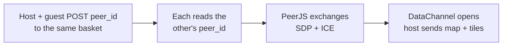

I enjoy building mini-games, even if nobody plays them TwT. However, adding multiplayer usually means paying for a backend server.

That was the problem I faced while building [GeoShuffle](https://geoshuffle.bittu.dev). I wanted two players to compete against each other, but the game was hosted as a static website and I did not want to pay for a server.

I looked into peer-to-peer technology and found that WebRTC can connect two browsers directly over the internet. Projects such as PeerJS provide a simpler WebRTC interface, but they do not solve one important problem: before two browsers can connect, they need a way to discover each other.

That is where my second project, [PeerBasket](https://peerbasket.bittu.dev), comes in. PeerJS will connect two browsers, but it has no idea which peer ID you want to dial -- something has to hold a list of who is currently looking for a game. Running that yourself means a service with an uptime bill, which is the exact cost I wanted to avoid. PeerBasket is that list, and it already runs at [peerbasket.bittu.dev](https://peerbasket.bittu.dev), so a game only needs to call one endpoint.


## The pattern: PeerBasket for discovery, WebRTC for gameplay

The useful part of PeerBasket is not that it runs GeoShuffle. It is that it gives any browser-based P2P game a small matchmaking primitive: a shared basket where players can temporarily find one another.

A P2P game normally has three separate jobs:

1. **Discovery:** find another player's peer ID.
2. **Connection:** establish a browser-to-browser WebRTC connection.
3. **Gameplay:** exchange the actual game state and events.

PeerBasket handles only the first job. PeerJS handles the connection setup, and the game sends its data through the resulting WebRTC data channel. This separation means a static game site can still support multiplayer without putting gameplay traffic through an application backend.

In GeoShuffle, the process looks like this:

1. Each browser creates a PeerJS ID.
2. Both players POST their IDs to the same PeerBasket basket.
3. PeerBasket returns the other active IDs in that basket.
4. One player uses the discovered ID to start a PeerJS connection.
5. Once the connection opens, GeoShuffle sends puzzle and match updates directly between the browsers.

PeerJS's signaling server exchanges the details needed to establish the WebRTC channel, while a STUN server helps the browsers discover their public network addresses. Neither service is the game's matchmaking database, and neither is where GeoShuffle's ongoing game messages are sent. The roles are:

- **PeerBasket:** a shared notice board for temporary player discovery
- **PeerJS and signaling:** connection setup
- **WebRTC:** direct data transport
- **Your game:** rules, state, and messages

>[!IMPORTANT]
> There is no relay in the middle. If two networks refuse to talk to each other (some corporate networks and symmetric NATs do), the match simply fails to connect. That's the trade-off for not paying for a TURN server.

## Add PeerBasket to your own game

PeerBasket is a small Go service with one endpoint, backed by Redis. It is already hosted, so there is nothing to sign up for or run: you POST a `peer_id` to `/basket/:name`, and the response contains every active peer in that basket:

```js
const res = await fetch("https://peerbasket.bittu.dev/basket/my-room", {
  method: "POST",
  headers: { "Content-Type": "application/json" },
  body: JSON.stringify({ peer_id: myPeerId }),
});
const { peers } = await res.json();
```

Each request does three jobs at once: it registers you, refreshes your heartbeat, and hands back everyone else. No separate join, leave, or account is required.

The basket name is your matchmaking strategy. Use a room-specific name for private lobbies, one shared name for quick match, or names based on a game mode, region, or map. Your client can then choose a peer from the response and connect using PeerJS:

```js
const { peers } = await findPlayers("my-game-public");
const opponent = chooseOpponent(peers);
const conn = peer.connect(opponent.peer_id);
```

`findPlayers` is just the request above, and `chooseOpponent` is whatever rule you use to decide who dials. The other browser does not need to poll anything; it accepts the incoming PeerJS connection with `peer.on('connection', ...)`, which is where the game messages start flowing.

After `conn.open`, stop treating PeerBasket as part of the game loop. Send only the messages your game needs over the data channel:

```js
conn.on("open", () => {
  conn.send({ type: "start_game", seed: 48291 });
});

conn.on("data", (message) => {
  if (message.type === "move") applyOpponentMove(message);
});
```

The important design decision is what to send. For a deterministic game, send a seed and player inputs. For a game that needs an authoritative host, have the host send the initial state and validate important events. PeerBasket does not define any of this; it only helps the peers meet.

Under the hood, each basket is a Redis sorted set where the score is the last time a peer checked in. Every request drops entries older than 30 seconds, returns the most recent `limit` peers, and refreshes the key's one-hour expiry. Close your tab and you stop heartbeating; 30 seconds later you're gone. No cleanup job, no ghost lobbies.

Even the "N online" counter in GeoShuffle is just this API: it posts a fake probe peer to a `geoshuffle-online` basket and reads the total back.

PeerBasket isn't GeoShuffle-specific, either. The repo ships examples for a 1:1 matchmaker chat, a browser-to-browser file drop, and a group video room. It pairs with anything that has a peer ID and no desire to run a lobby database.

## How GeoShuffle wires it up

A private lobby is the easiest implementation. The host generates a room code like `K3F9QZ` and uses a basket named `geoshuffle-K3F9QZ`. It posts its PeerJS ID there every 12 seconds so it remains discoverable. The guest enters the code, posts its own ID to the same basket, and receives the host's ID. The guest then dials the host, and the game begins.

Quick match uses the same idea with a shared basket called `geoshuffle-public-matchmaking`. Both players post their IDs and receive the list back. Without coordination, both could try to dial at once, so GeoShuffle uses a deterministic tie-break: the peer with the lexicographically smaller ID dials, while the other waits. Your game could use the same rule, or have the discovery response assign a host.

When the dial connects, the guest sends a `match_request`, the host replies with `match_accept` and a fresh room code, and both sides flip into the playing state.



## Who owns the board

Once the channel is open, GeoShuffle's host becomes the source of truth for the puzzle. It picks a map, shuffles it, and sends the whole thing across:

```js
conn.send({ type: "start_game", mapIndex, tiles });
```

The guest applies those tiles and starts from the exact same scrambled board, so nobody has to argue about whether the puzzle was solvable.

After that the two boards run independently -- this is a race, not a turn-based game. What actually crosses the wire is small:

| Message | Sent by | What's inside |
|---|---|---|
| `start_game` | host | the map and the shuffled tile array |
| `move_update` | both | your current move count |
| `victory` | both | your final time and move count |
| `request_new_game` | guest | "run it back" |
| `opponent_ready_replay` | both | "I'm ready when you are" |
| `ping` / `pong` | both | heartbeat |

The board is shared once at the start, and the live sync is your move count ticking up next to your opponent's. Which, honestly, is the fun part: watching someone else suffer through the same puzzle at the same speed as you.

## Keeping the line honest

A WebRTC connection can die quietly, especially when one side walks away from the laptop. To catch that, GeoShuffle sends a heartbeat over the data channel itself. Every 10 seconds, each side sends a `ping`. Three missed beats in a row -- about 30 seconds -- closes the connection and shows the disconnect state.

A new handshake gets 10 seconds before it is considered dead. That is also how quick match recovers: a slow candidate simply means it is time to search again.

## Try it

- Play: [geoshuffle.bittu.dev](https://geoshuffle.bittu.dev)
- Source: [GeoShuffle](https://github.com/Bittu5134/GeoShuffle)
- API: [peerbasket.bittu.dev](https://peerbasket.bittu.dev)
- Source: [PeerBasket](https://github.com/Bittu5134/PeerBasket)

## Conclusion

PeerBasket does not replace WebRTC or PeerJS. It solves the smaller problem that comes first: helping two browsers find each other. Once they connect, the game can keep its gameplay traffic between the players instead of sending every move through a game server.
